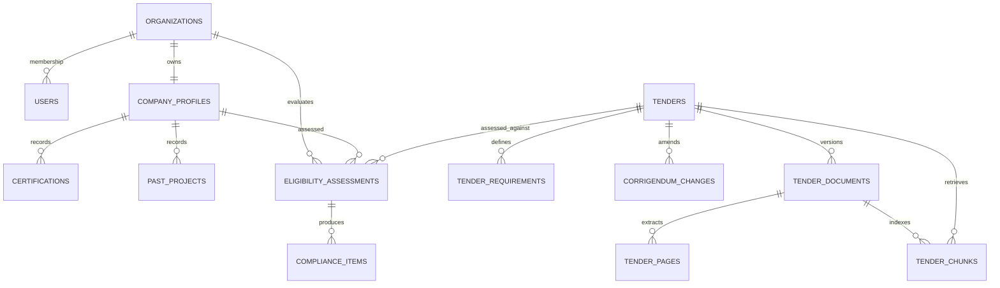

# TenderAI entity relationships

## Core data rules
- Tender catalogue and tender source documents represent public procurement information.
- Company profile, certifications, past projects and assessments are scoped to the authenticated organization.
- `tender_documents.sha256` prevents identical document content from being uploaded repeatedly to the same tender.
- `tender_pages.page_number` and `tender_chunks.page_number` preserve page-level evidence provenance.
- `tender_chunks.embedding` stores 384-dimensional normalized BGE vectors; `search_vector` is a generated PostgreSQL `tsvector`.
- Corrigendum changes preserve both original and amendment document references.
- Eligibility assessments store the structured report snapshot; checklist completion is stored separately.

## Migrations
- `0001_initial_schema.py`: original TenderAI foundation.
- `0002_intelligence.py`: document pages, vector chunks, corrigendum diffs, checklist rows, GIN/HNSW indexes and DPIIT startup recognition field. The DPIIT column migration checks existing schema so it upgrades both a fresh install and a Phase 1 database.
